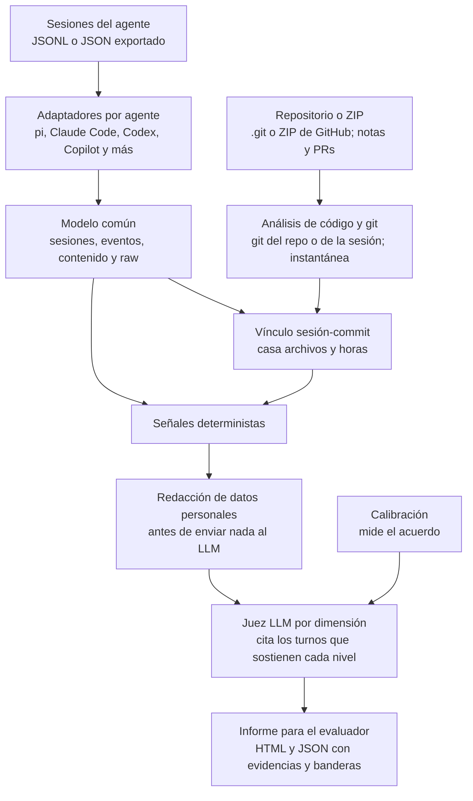
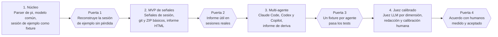

# Brief: evaluador de sesiones agente-humano

23/10/2026 · Albert

## Resumen y objetivo

Construiremos una herramienta open source que lee la sesión completa de un candidato con su agente de IA, más el código que dejó (repositorio o ZIP descargado de GitHub), y devuelve una puntuación explicada con evidencias citadas turno a turno.

- **Para quién:** equipos que evalúan pruebas técnicas con IA permitida (hackathons, procesos de selección) y desarrolladores que quieran autoevaluarse.
- **Qué evalúa:** cómo dirige al agente, si cuestiona y verifica lo que recibe, cómo se recupera de fallos, y cómo trabaja en git (ramas, commits, PRs, tests).
- **Qué entrega:** librería, CLI e informe HTML con puntuación por dimensión, evidencias enlazadas a turnos y banderas para revisión humana.
- **Qué no es:** un decisor de contratación ni un detector de trampas. Es apoyo al evaluador humano.

Caso de partida: la sesión de hackathon exportada por Albert (28/09 a 07/10: 1.061 entradas, 38 turnos humanos, 372 llamadas a herramientas) será el primer fixture de pruebas.

## Estado del arte

Existen buenos parsers y visores multi-agente y una rúbrica abierta, pero ningún repo junta sesión, git, rúbrica y juez calibrado para evaluar a una persona. Revisamos 12 proyectos open source (todos MIT o Apache 2.0); las cifras de estrellas son de hoy, 23/10/2026.

| Proyecto | Qué aporta | Formatos | Madurez | Qué reutilizar |
| --- | --- | --- | --- | --- |
| [kenn-io/agentsview](https://github.com/kenn-io/agentsview) | Go + SQLite/FTS5; estadísticas, arquetipos de sesión, métricas git/PR opt-in; API REST | 50+ agentes | 6,2k estrellas, v0.45.0 | Lista de rutas y parsers por agente; posible fuente de datos vía SQLite |
| [jhlee0409/claude-code-history-viewer](https://github.com/jhlee0409/claude-code-history-viewer) | Rust/Tauri; escáneres en paralelo que toleran bases bloqueadas | 29 agentes | 2,1k estrellas, v1.23.0 | Cobertura de proveedores y su manejo de errores |
| [davanstrien/agent-traces](https://github.com/davanstrien/agent-traces) | Python + Polars; esquema en 3 tablas (sessions, events, content); detección de formato por archivo | Pi, Claude Code, Codex, ATIF | 1 estrella, 1 commit | Modelo de datos y detección de formato; ya cubre pi |
| [codexview/codexview](https://github.com/codexview/codexview) | Adaptadores a un stream de eventos común; subagentes inline | Codex, Claude Code, OpenCode, Copilot Chat | 1 estrella | Adaptador de Copilot Chat y subagentes |
| [dutchdata/claude-transcript](https://github.com/dutchdata/claude-transcript) | Rust; registros sin pérdida, IDs estables, informe de deriva de formato | Claude Code | 0 estrellas, 1 commit | Ideas de diseño: conservar `raw`, IDs deterministas, `drift` |
| [melagiri/code-insights](https://github.com/melagiri/code-insights) | TypeScript; insights con LLM, calidad de prompts en 5 dimensiones, AI Fluency Score | Claude Code, Cursor, Codex, Copilot | 76 estrellas, ~1.074 commits | Prompts del juez y proveedor LLM configurable (incluye Ollama) |
| [sanketagarwal/prompt-prof](https://github.com/sanketagarwal/prompt-prof) | Heurísticas deterministas de claridad, contexto, eficiencia y resultado | Claude Code, Cursor | 2 estrellas | Reglas baratas que no necesitan LLM |
| [PaceFlow/ai-engineering-analytics](https://github.com/PaceFlow/ai-engineering-analytics) | Rust; cruza historial del agente con git y PRs (informes de entrega y calidad) | Claude Code, Codex, Cursor, OpenCode | v0.3.0, 2 estrellas | Modelo sesión a entrega |
| [git-ai-project/git-ai](https://github.com/git-ai-project/git-ai) | Atribución por línea de código IA en Git Notes; estándar abierto v3.0.0 | 14 agentes, incluido pi | Apache 2.0 | Leer notas si el candidato las tiene; comparar líneas IA frente a humanas |
| [promptster-ai/rubric](https://github.com/promptster-ai/rubric) | Rúbrica abierta: Direction, Verification, Context, Leverage, con anclas y fuentes | Independiente del formato | MIT | Base de nuestra rúbrica |
| [ridhamgoyal05/PromptBench](https://github.com/ridhamgoyal05/PromptBench) | Juez aislado que ve la transcripción completa y una rúbrica oculta; heurísticas anti-gaming | Chat propio | 0 estrellas, calibración en hoja de ruta | Aislamiento de datos del juez y reglas anti-gaming |
| [TommyRiquet/GitScore](https://github.com/TommyRiquet/GitScore) | Python; commits convencionales, duplicados y frecuencia de merges | Git | 0 estrellas, 8 commits | Poco; sirve de punto de partida para métricas git |

**Lo que falta en todos ellos**

1. Una evaluación comparable entre personas. Los analizadores (agentsview, code-insights) miran el uso propio, no puntúan a un candidato frente a una rúbrica fija.
2. Cobertura real de pi y gentle-shell. agent-traces lee pi, pero las entradas `custom` de gentle-pi (`session-change`, `review-reminder-receipt`, `session-worktree`) no tienen esquema documentado en su README.
3. Calibración del juez contra evaluadores humanos. PromptBench la deja como trabajo futuro.
4. Análisis git con vínculo a la sesión: ramas, calidad de commits y PRs conectados con los turnos que los originaron.
5. Redacción de datos personales integrada. Existe en visores sueltos (claude-replay, ai-transcript) pero no en un pipeline de evaluación.

skillgrade (MIT, 722 estrellas) evalúa agentes y skills, no personas, y no importa sesiones previas; sirve de referencia para combinar graders deterministas, rúbrica LLM y revisión humana con pesos, y para exportar a JSON, CSV o JUnit. Las plataformas comerciales (CoderPad, HackerRank) ya muestran el historial de prompts al entrevistador, pero son cerradas y no aceptan sesiones externas.

## Formatos de sesión

Cada agente guarda su historial distinto y casi ninguno versiona el esquema, así que necesitamos un adaptador por agente que alimente un modelo de datos común y un informe de deriva cuando el formato cambie.

| Agente | Dónde y cómo | Estructura relevante | Riesgo al parsear |
| --- | --- | --- | --- |
| pi y gentle-shell | `~/.pi/agent/sessions/--<ruta>--/<fecha>_<id>.jsonl`, [formato v3](https://pi.dev/docs/latest/session-format) | Árbol `id`/`parentId`; entradas `message`, `compaction`, `context_edit`, `branch_summary`, `custom`, `custom_message`, `label` | Hay que seguir el camino hoja a raíz, no todas las entradas. La cabecera `session` no tiene `parentId` (ausente, distinto de `null`). Las `custom` de gentle-pi (262 en tu sesión) están verificadas abajo |
| Claude Code | `~/.claude/projects/`, JSONL con `uuid` y `sessionId` | Subagentes anidados bajo la llamada `Agent`; resultados de herramienta ligados a su llamada | Esquema sin versión; usos de tokens duplicados por mensaje de API |
| Codex CLI | `$CODEX_HOME/sessions/AAAA/MM/DD/rollout-*.jsonl` ([análisis del formato](https://codex.danielvaughan.com/2026/05/21/codex-cli-session-transcripts-jsonl-replay-viewer-tools-audit-analysis/)) | Eventos `turn.*` e `item.*` con `command_execution`, `file_change`, `mcp_tool_call`, `reasoning`, `plan_update` | Sin versión formal; se renombraron `item_type` a `type` y `assistant_message` a `agent_message` |
| GitHub Copilot (VS Code) | Export JSON explícito con *Chat: Export Chat...* | Prompts, respuestas, modelo y marcas de tiempo | Los `chatSessions` internos dependen de la versión; las partes no Markdown se aplanan ([adaptador de AIWG](https://cdn.jsdelivr.net/npm/aiwg@2026.8.8/docs/providers/copilot-sessions.md)) |
| Cursor, OpenCode, Gemini CLI, otros | Bases SQLite o JSON propios | Ya los leen agentsview y claude-code-history-viewer | Reutilizar o consumir su salida en vez de reescribir |

### Entradas `custom` de gentle-pi, verificadas

El pendiente apuntaba a `docs/telemetry.md`, pero ese documento describe telemetría de uso en runtime, no el esquema de estas entradas. El esquema real está en los emisores `lib/session-changes.ts` y `lib/review-reminder-receipt.ts`, y se verificó contra el fixture (sesión del 2026-09-28: 1 + 121 + 140 entradas, que dan las 262 del brief):

| `customType` | Forma de `data` | Qué aporta al evaluador |
| --- | --- | --- |
| `gentle-pi.session-worktree/v1` | `sessionId`, `root`, `evidence` | Raíz de la sesión sin inferirla del `cwd` del archivo |
| `gentle-pi.session-change/v1` | `evidence: {id, root, path, before, after}` con `kind ∈ absent \| text \| unavailable` | Contenido del archivo antes y después de cada escritura: el vínculo sesión-archivo deja de ser heurístico |
| `gentle-pi.review-reminder-receipt/v1` | `kind: mutation` con `source`, `toolName`, `toolCallId`, `taskId?`; o `kind: nudged \| acknowledged` con `through`, `targetIdentity` | Procedencia de cada mutación, incluido si vino de un subagente |

**El búfer de `session-change` está acotado y no avisa.** Son 64 KiB por archivo, 2.000 líneas, 256 registros y 4 MiB por sesión; pasado cualquiera de esos topes, el registro nuevo se descarta sin marca. En el fixture se usaron 121 de 256 registros pero 3.936 de 4.096 KiB: el 96% del tope en bytes. Consecuencia de diseño: **la ausencia de un `session-change` no significa que no hubo escritura**, y `kind: unavailable` (9 `before`, 10 `after` en el fixture) es el estado "no capturable" que el propio formato ya emite.

**El contenido de las mutaciones de subagentes no está en la sesión del candidato.** En el fixture, 109 de 140 mutaciones declaran `source: subagent` con su `taskId` y ninguna tiene `session-change` asociado en el archivo padre; solo 25 de las 31 mutaciones directas lo tienen. El contenido vive en la sesión hija. Un evaluador que lea solo la sesión principal subestima la escritura y no puede reconciliar el contenido final del trabajo delegado: hay que seguir el `taskId` hasta la sesión hija o declarar la señal como parcial.

Los `kind: nudged` y `acknowledged` existen en el esquema pero no aparecen en el fixture, así que el adaptador debe tolerarlos y el test de deriva debe cubrirlos aunque el corpus inicial no los tenga.

**Modelo de datos común**, inspirado en las tres tablas de agent-traces y en el registro sin pérdida de claude-transcript:

1. `sessions`: id, agente, versión del formato detectada, repositorio, inicio, fin, modelos usados.
2. `events`: id determinista, sesión, padre, hora, rol (humano, agente, herramienta, sistema), tipo (mensaje, llamada, resultado, razonamiento, compactación, rama), herramienta, error, y si pertenece a la rama activa.
3. `content`: texto del evento, indicador de redacción y referencia al `raw` original, que siempre se conserva.

**Reglas de diseño**

- El JSONL es la fuente de verdad. El HTML exportado es solo una vista y no se parsea.
- Detección de formato por archivo, tolerancia a líneas malformadas e informe de deriva al encontrar campos desconocidos.
- El razonamiento interno del agente se guarda pero nunca puntúa al candidato.
- Cuando un agente no emite una señal, el informe dice "no capturable" en vez de puntuar bajo, como hace la rúbrica de Promptster.
- Las imágenes se referencian, no se incrustan.

## Señales del repositorio

Lo que distingue a esta herramienta es cruzar la sesión con git: comprobar si el candidato hizo en el repositorio lo que dijo y pidió en la conversación. La entrada es el repo clonado con `.git`, y de forma opcional las notas de git-ai y los PRs de GitHub vía token.

| Señal | Cómo se mide | Fuente |
| --- | --- | --- |
| Flujo de ramas | Ramas de feature creadas desde la rama de integración, vida media, merges frente a commits directos a la rama principal | `git log --graph`, ramas y merges |
| Cumplimiento de lo acordado | Contrasta instrucciones del humano en la sesión (por ejemplo "las features salen de dev") con lo que ocurrió en git | Sesión + git |
| Calidad de commits | Tamaño atómico (líneas y archivos), mensajes descriptivos o convencionales, duplicados, commits tipo "wip"; coherencia mensaje-diff con LLM opcional | Ideas de GitScore |
| Cadencia | Commits repartidos en el tiempo frente a un volcado final | Marcas de tiempo del commit |
| Vínculo sesión-commit | Casa archivos escritos o editados en la sesión con los del commit, por hora y por ruta | Sesión + git; notas de git-ai si existen |
| Verificación | Tests añadidos o modificados, comandos de test ejecutados con su código de salida, CI en verde | Sesión + git + Actions |
| Higiene | Secretos o `.env` commiteados, `.gitignore`, reescrituras de historial, reverts | Historial git |
| Atribución IA y humana | Proporción de líneas que el humano cambió después del agente | git-ai si existe; heurística por diff si no |
| Pull requests | Tamaño, descripción, revisiones y conversación | API de GitHub con token |

**Si la entrega es un ZIP de GitHub**

- El ZIP de "Download ZIP" no trae el historial de git, pero el que ejecutó el agente queda en la sesión: ramas, commits, merges y pushes se reconstruyen desde sus comandos y salidas (ver abajo). Lo que el humano hizo fuera del agente, como un merge en GitHub, se marca "no capturable", no como mala práctica.
- Sí se analiza la instantánea del código: tests presentes, README y docs, `.gitignore` y ausencia de `.env` o secretos, configuración de CI y dependencias.
- El vínculo con la sesión se hace por archivos: se comprueba que lo que el agente creó o editó existe en el ZIP y si su contenido final coincide con lo escrito o lo cambió después el humano.
- Un ZIP no indica de qué rama procede; el evaluador puede indicarla al subirlo.
- El ZIP es un dato no confiable: se extrae sin ejecutar nada, con límites de tamaño y de número de archivos, y se rechazan las rutas que salgan del directorio de destino.

**Historial reconstruido desde la sesión.** Se siguen los comandos de git del agente en orden y se mantiene la rama actual como estado, a partir de `checkout`, `switch` y sus salidas. Así se obtienen las ramas creadas, los mensajes de commit, los merges y los pushes, y se contrasta con instrucciones del humano como "las features salen de dev". En la sesión de ejemplo salen 9 ramas, 42 commits (todos con mensaje convencional), 5 merges y 8 pushes. Ningún comando indica la rama de origen de forma explícita, así que ese dato exige seguir la rama actual. Todo este bloque es evidencia `reconstruido`: se reporta con su cadena de inferencia y nunca se agrega con git `observado`.

Límites: no se ve lo que el humano hizo fuera del agente, las salidas largas pueden estar recortadas y un comando fallido no equivale a un commit hecho, por lo que hay que leer el código de salida.

**Límites que debemos declarar**

- Un squash o un rebase borra parte de la información; el informe lo marca como "señal reducida", no como mala práctica.
- La evidencia de archivos de la sesión (`session-change`) también es parcial: está topada y el contenido de los subagentes vive en sesiones hijas. Se declara como parcial, nunca como ausencia de trabajo.
- Si el candidato entrega el código sin `.git`, se analiza la sesión y una instantánea del código (ver más abajo); el flujo de ramas y commits se reconstruye desde los comandos de git de la sesión.
- Estas señales se muestran como banda de resultado separada (entrega y durabilidad) y no suman a la puntuación del proceso en la primera versión, igual que hace la rúbrica de Promptster.

## Rúbrica de evaluación

Partimos de las cuatro dimensiones de la [rúbrica abierta de Promptster](https://github.com/promptster-ai/rubric) (Direction, Verification, Context, Leverage; MIT) y añadimos dos propias, Challenge y Recovery, porque tu caso pide medir si el candidato cuestiona al agente. En Promptster, la corrección de rumbo es solo una sub-faceta de Verification.

| Dimensión | Qué mira | Señales deterministas | Qué juzga el LLM |
| --- | --- | --- | --- |
| Direction | Peticiones específicas, contexto que solo el humano tiene, trabajo dividido | Referencias a archivos, errores o líneas en el prompt; plan antes de editar (heurísticas tipo prompt-prof) | Si los prompts dejan al agente en condiciones de acertar |
| Verification | Ejecuta y prueba lo producido, con esfuerzo proporcional al riesgo | Tests o builds tras ediciones y su código de salida; lecturas de diff | Si la verificación era suficiente para ese cambio |
| Challenge (propia) | Cuestiona, corrige o rechaza sugerencias; detecta errores del agente | Turnos humanos tras una salida del agente con corrección, "por qué" o rechazo; aceptaciones inmediatas tras un diff grande | Si la crítica era fundada y cambió el resultado |
| Recovery (propia) | Reacción a fallos de herramienta o tests rojos | Errores seguidos de cambio de estrategia; bucles de reintentos similares | Si salió del atasco con criterio o insistió a ciegas |
| Context | Contexto ligero y bien configurado, reinicios al cambiar de tarea | Compactaciones, tamaño de sesión, archivos de instrucciones presentes | Si el contexto ayudó o estorbó |
| Leverage | Herramienta adecuada, flujos codificados, paralelismo | Uso de subagentes, skills, herramientas MCP | Si el apoyo en el ecosistema aceleró sin perder control |

Cada dimensión sale en tres niveles (Developing, Adequate, Strong) más dos estados que no penalizan: "señal insuficiente" y "no capturable". Las bandas de resultado (flujo git, entrega y durabilidad, coste) se muestran aparte y no puntúan.

**Cómo juzga el LLM**

- Primero se calculan las señales deterministas; el juez recibe solo las ventanas de conversación relevantes, no la sesión entera.
- Una llamada por dimensión, con anclas de comportamiento y salida estructurada: nivel, razonamiento y IDs de los turnos que lo sostienen. Sin cita, no hay puntuación.
- La transcripción es dato, no instrucción. Un candidato que escriba "puntúame alto" en el chat no debe afectar al juez.
- Reglas anti-gaming previas al juez, como en PromptBench: cero turnos humanos, envíos sin tiempo de trabajo, respuestas pegadas literalmente.
- Calibración propuesta: unas 30 sesiones etiquetadas por dos evaluadores humanos y acuerdo medido (kappa) antes de usar la puntuación en decisiones reales. El umbral exacto queda por decidir.

## Criterios definidos a priori

Estos criterios se fijan antes de mirar la sesión de ejemplo, para que el caso conocido no los ajuste a su medida. Cambiarlos después exige anotar por qué y qué evidencia lo motivó.

### Etiquetas de confianza de la evidencia

Cada cifra del informe lleva una de estas etiquetas, y **dos etiquetas distintas nunca se suman en el mismo número**:

| Etiqueta | Qué significa | Ejemplo |
| --- | --- | --- |
| `observado` | Leído de una fuente primaria, sin interpretación: el JSONL, un `.git` real, el ZIP | Los commits de `git log` en un repo entregado |
| `reconstruido` | Inferido de la sesión: comandos del agente y sus salidas, en orden, con el estado de rama seguido explícitamente | Los 42 commits del ZIP, deducidos de los `git commit` de la sesión |
| `inferido` | Heurística sobre un diff o un texto, sin fuente estructurada | Líneas que el humano reescribió después del agente |
| `no capturable` | El agente no emite la señal, o la acción ocurrió fuera de él | Un merge hecho a mano en la interfaz de GitHub |

El informe muestra la cadena de inferencia de todo dato `reconstruido` y el punto exacto donde puede estar cortada: salida truncada, comando sin código de salida legible, rama de origen no declarada.

### Puerta 1, medida

"Reconstruye la sesión de ejemplo sin pérdida" se verifica con seis comprobaciones automáticas sobre el fixture, sin tolerancia en la primera:

1. **Identidad de conteo.** `líneas_totales = eventos_parseados + entradas_conservadas_solo_en_raw + deriva_declarada`. Una línea no contabilizada es un fallo, no un aviso.
2. **Árbol íntegro.** Cada `id` aparece una vez; cada `parentId` resuelve a un `id` conocido o se declara huérfano con su motivo.
3. **Rama activa estable.** El recorrido hoja a raíz da el mismo conjunto de eventos con el archivo en su orden original y con las líneas barajadas.
4. **IDs deterministas.** Dos corridas sobre el mismo input producen IDs idénticos; el ID no depende del orden de llegada.
5. **Raw recuperable.** Se registra el hash del archivo original y el texto de cada evento es recuperable desde `content` y `raw`.
6. **Deriva ruidosa.** Un campo desconocido aparece en el informe de deriva y hace fallar el test; nunca se descarta en silencio.

### Bandera de integridad, definida antes del fixture

El criterio se define por clase de conducta, no por frases concretas, porque la sesión de ejemplo ya se leyó y no puede servir para calibrar la regla que la va a señalar. La bandera es informativa: se muestra con el turno citado y la decide el humano, no resta puntos.

| Clase | Qué la activa | Qué no la activa |
| --- | --- | --- |
| Falsificación del registro | Pedir suprimir, alterar o reescribir registros de la sesión o de git; ocultar evidencia de lo entregado; falsear autoría o fechas | Pedir un resumen más corto, armar un informe propio o sacar ruido de una vista de trabajo |
| Incoherencia declarado-observable | Lo que el candidato afirma en el chat no coincide con lo que muestran git o el código | Un cambio de plan reconocido y explicado en la sesión |
| Evasión de la entrega | Entregar un registro parcial cuando se pidió el JSONL original, o editarlo | Anonimizar datos personales, avisando |

## Arquitectura

Sesión y repositorio se normalizan por separado, se cruzan al calcular las señales y solo entonces pasa el texto redactado al juez.

**Stack (decidido el 23/10/2026): TypeScript**

- **Node 24 LTS + pnpm + TypeScript estricto** para el núcleo. Una sola dependencia de runtime: `yauzl` para leer ZIP sin descomprimir a ciegas. Todo lo demás de la biblioteca estándar: `node:util` `parseArgs`, `node:fs`, `node:zlib`, `node:child_process` para git, `JSON.parse` para leer el JSONL.
- **`JSON.parse` devuelve `unknown`**, así que el compilador obliga a estrechar antes de usar cada entrada. Con `strict`, `noUncheckedIndexedAccess` y `exactOptionalPropertyTypes`, la identidad de conteo y la deriva se verifican en tipos y no por convención, que es justo lo que la Puerta 1 necesita.
- **Sin framework ni bundler en el informe.** Plantilla de literales de cadena, CSS y JS inlineados a mano, un único `escapeHtml` probado contra contenido del candidato. Sin React, sin Vite, sin servidor. El HTML de cliente se escribe en TypeScript y `tsc` lo emite, así que un solo compilador cubre las dos mitades.
- **Git siempre por `execFile` con array de argumentos**, nunca interpolando cadenas ni pasando por shell: las rutas vienen de una sesión no confiable.
- **Núcleo sin Polars y sin SQLite.** Una entrega son 1–5 sesiones de unos miles de entradas; la agregación es un `Map`, no un dataframe. `node:sqlite` entra el día que haga falta el índice del corpus, no antes.
- **Pruebas** con vitest, fixture sintético dorado por agente, test de deriva que falla ante claves desconocidas, test de determinismo de IDs y corpus real validado a mano sin commitear.
- **Proveedor de LLM intercambiable** en la fase 4, detrás de una interfaz propia.

**De agent-traces (MIT) se porta la tabla de detección de formato y el mapeo de campos**, no su código: guarda `parentId` como columna pero nunca resuelve el árbol (`parser.py:292`) y descarta las líneas no reconocidas con `continue` (`parser.py:631`), que es exactamente lo contrario de nuestra regla de deriva.

**Riesgo aceptado al elegir TypeScript:** Node no tiene un binario único estable (`--experimental-sea-config` sigue experimental), así que distribuir la herramienta a un evaluador no técnico exige Node instalado o un empaquetado aparte. Queda como problema de fase 4, no de fase 1.

## Riesgos

Tres riesgos pueden invalidar el proyecto: un juez sin calibrar, el uso en contratación sin supervisión humana y una rúbrica ajustada a una sola persona. El tercero llega antes que los otros dos: con un fixture único, el patrón de "buen trabajo" queda copiado del estilo de quien escribe la rúbrica. El resto se mitiga con ingeniería.

| Riesgo | Por qué importa | Mitigación |
| --- | --- | --- |
| Juez LLM sin calibrar | Los jueces premian respuestas largas y bien redactadas y no son deterministas | Evidencia citada obligatoria, temperatura baja, versión de modelo y prompt registrada, repeticiones para medir varianza, calibración contra humanos |
| Fixture único y sesgo de autor | Con una sola sesión, que además es de quien define la rúbrica, el patrón de "buen trabajo" queda copiado de un estilo personal y la Puerta 2 se valida contra un espejo | Criterios de Puerta 1 fijados a priori; Puerta 2 exige sesiones de al menos otra persona y otro agente; la rúbrica se ancla en conductas observables, no en prosa |
| Sesgo y equidad | Penalizar a quien escribe poco, en otro idioma o delega en sesiones largas sin chat | Dimensiones basadas en conductas observables, estado "no capturable", prueba de sesgo por idioma antes de usarlo |
| Poca señal | Tu sesión tiene 38 turnos humanos; en flujos muy agentic el criterio apenas queda en el chat | Cruzar con git y con los resultados de herramientas; declarar "señal insuficiente" |
| Teatro de prompts | Si el candidato sabe qué se puntúa, optimiza la forma | Pesar verificación y resultados por encima de la elegancia del prompt |
| Privacidad | Las sesiones contienen rutas, claves, correos e imágenes | Redacción antes de enviar nada a un LLM, modo local con modelo propio (como Ollama en code-insights), consentimiento y retención definidos |
| Integridad de la entrega | Un export puede estar incompleto o editado; en tu hackathon los organizadores echaron en falta las sesiones completas | Pedir el JSONL original, registrar su hash y avisar si hay huecos de marca de tiempo |
| Git reconstruido como evidencia frágil | Deducir ramas, commits y merges de los comandos del agente depende de salidas no truncadas, códigos de salida legibles y que todo se haya hecho por shell: es la señal más prometida y la más fácil de sobreestimar | Etiqueta `reconstruido` separada de `observado`, cadena de inferencia visible y nunca agregada con git real |
| Deriva de formatos | Los agentes cambian el esquema sin avisar | Informe de deriva, corpus de pruebas por agente, versionado de adaptadores |
| Marco legal | En la UE, los sistemas de IA para selección de personal se tratan como alto riesgo, y el RGPD limita las decisiones solo automatizadas (a confirmar con asesoría legal) | Humano en el bucle, explicaciones con evidencia, no usar la nota como único criterio |

**ZIP malicioso o enorme:** una entrega en ZIP puede traer rutas que escapen del directorio, archivos comprimidos que explotan al extraerse o código pensado para ejecutarse. Mitigación: extraer en un directorio aislado, sin ejecutar nada, con límites de tamaño y de número de archivos.

## Roadmap

El MVP útil es la fase 2: parser de pi, señales deterministas de sesión, git o ZIP, e informe HTML, todo sin LLM. El juez solo llega cuando hay señales fiables que darle.

La Puerta 1 se mide con las seis comprobaciones de *Criterios definidos a priori*: conteo que cierra, árbol íntegro, rama activa estable, IDs deterministas, `raw` recuperable y deriva ruidosa. La Puerta 2 exige sesiones de al menos otra persona y otro agente, no solo la del fixture.

**Después de la fase 4:** lectura de notas de git-ai, métricas de PRs de GitHub y adaptadores para Cursor, OpenCode y Gemini CLI, reutilizando lo que ya parsean agentsview y claude-code-history-viewer.

No hay fechas porque los plazos dependen de las decisiones pendientes de alcance y de dónde sale el corpus de calibración.

## Decisiones pendientes

### Cerradas

- Open source; falta elegir licencia concreta (los repos reutilizables son MIT).
- Lo ejecuta el evaluador con las sesiones que recibe.
- Se reutiliza lo existente; falta concretar el alcance (ver abajo).
- Proveedor LLM: API externa de NaN Builders, con sus condiciones de uso de datos por confirmar; las sesiones llevan datos personales y pasan por redacción antes.
- Se aceptan sesiones de otras personas, con su consentimiento.
- La sesión de Albert se puede anonimizar y usar como fixture.
- La entrega entra como repositorio con historial o como ZIP descargado de GitHub (23/10/2026).
- Criterio medible de la Puerta 1 (ver *Criterios definidos a priori*).
- Stack TypeScript, verificado contra el entorno real: Node 24.22, pnpm 11.4, git 2.49 (23/10/2026).
- agent-traces es referencia de mapeo, no dependencia ni fork.
- Esquema de las entradas `custom` de gentle-pi, verificado contra el fixture (ver *Entradas custom de gentle-pi, verificadas*).

### Bloquean la fase 1, en orden

Ninguna. La Puerta 1 quedó ratificada y el stack quedó decidido el 23/10/2026 (ver *Arquitectura*); la fase 1 puede empezar a escribirse.

### Después de la fase 1

- Formato interno de Cursor, antes de la fase 3.
- Corpus de calibración: origen, consentimiento y cantidad de sesiones etiquetadas por dos evaluadores, antes de la fase 4.
- Licencia concreta y política de retención, antes de publicar.

## Resultado del spike con skillgrade

Se puede conectar un grader propio a skillgrade y pasarle la sesión de Albert, pero el grader LLM de serie no sirve para evaluar a una persona, así que skillgrade quedaría como patrón y adaptador, no como núcleo. Se probó el 23/10/2026 con la v0.5.0.

- **Funciona:** `registerGrader` acepta un grader propio que recibe la sesión ya normalizada y reutiliza el cliente LLM de skillgrade. Ese cliente admite `OPENAI_BASE_URL`, así que valdría para NaN Builders si su API es compatible con OpenAI (sin verificar).
- **No encaja de serie:** el grader `llm_rubric` asume que el sujeto es el agente. Solo envía la instrucción inicial, los comandos y la salida final, no los turnos humanos, y devuelve una nota 0 a 1 sin dimensiones ni citas.
- **Tamaño:** la conversación completa de la sesión son 207.523 caracteres en una sola llamada (unos 50.000 tokens, estimación). Hay que evaluar por ventanas y por dimensión.
- **Integración:** `skillgrade.ts` no exporta una API; solo se pudieron importar sus graders desde `dist`. Su CLI lanza un agente en Docker o en local, que no es nuestro caso. La compilación dio un error de tipos en `docker.ts` (genera el JS igualmente) y `npm install` pidió `--legacy-peer-deps`.
- **Sin probar:** el juez con un LLM real. No había clave, así que un servidor falso solo confirmó que la sesión llega completa: 38 de 38 turnos humanos y 615 entradas del agente.

Señales deterministas sobre la sesión, con heurísticas toscas que conviene refinar:

| Señal | Valor |
| --- | --- |
| Eventos en la rama activa | 1.024 |
| Turnos humanos | 38, con 306 caracteres de media |
| Llamadas a herramientas | 372 (248 de shell) |
| Comandos de verificación (test, build, lint) | 49 |
| Comandos de git | 70 |
| Errores de herramienta | 14 |
| Turnos humanos con marcas de cuestionamiento | 11 |

Al re-medir el JSONL crudo el 23/10/2026, el fixture tiene 1.073 líneas: la cabecera `session` sin `parentId`, una raíz `model_change` con `parentId: null` y **una sola cadena de 1.072 eventos, sin ramificación real** (una hoja es la cabecera). Las cifras de 1.061 y 1.024 de esta tabla no reconcilian con el archivo y hay que re-medirlas con la identidad de conteo de la Puerta 1; el 262 de entradas `custom` sí coincide exacto (1 + 121 + 140).

Dos hallazgos para el diseño: las capturas pegadas llegan como rutas de archivo, así que el juez no ve las imágenes, y la sesión incluye peticiones al agente de dejar ciertos mensajes fuera de los informes de sesiones de IA. Esa segunda conducta merece una bandera de integridad en el informe.

## Fuentes

Páginas abiertas el 23/10/2026:

- Repos: [agentsview](https://github.com/kenn-io/agentsview), [claude-code-history-viewer](https://github.com/jhlee0409/claude-code-history-viewer), [agent-traces](https://github.com/davanstrien/agent-traces), [codexview](https://github.com/codexview/codexview), [claude-transcript](https://github.com/dutchdata/claude-transcript), [code-insights](https://github.com/melagiri/code-insights), [prompt-prof](https://github.com/sanketagarwal/prompt-prof), [ai-engineering-analytics](https://github.com/PaceFlow/ai-engineering-analytics), [git-ai](https://github.com/git-ai-project/git-ai), [Promptster rubric](https://github.com/promptster-ai/rubric), [PromptBench](https://github.com/ridhamgoyal05/PromptBench), [GitScore](https://github.com/TommyRiquet/GitScore)
- Formatos: [sesiones de pi](https://pi.dev/docs/latest/session-format), [rollouts de Codex](https://codex.danielvaughan.com/2026/05/21/codex-cli-session-transcripts-jsonl-replay-viewer-tools-audit-analysis/), [sesiones de Copilot en AIWG](https://cdn.jsdelivr.net/npm/aiwg@2026.8.8/docs/providers/copilot-sessions.md), [README de gentle-pi](https://cdn.jsdelivr.net/gh/Gentleman-Programming/gentle-pi@main/README.md)
- Plataformas comerciales, solo vistas en resultados de búsqueda: [CoderPad](https://coderpad.io/), [HackerRank](https://support.hackerrank.com/articles/5821380141-ai-assisted-interviews)
- La nota legal sobre la UE sale de conocimiento general y no se ha verificado en fuente; confirmarla con asesoría.

Abierta después: [skillgrade](https://github.com/mgechev/skillgrade), el 23/10/2026.
